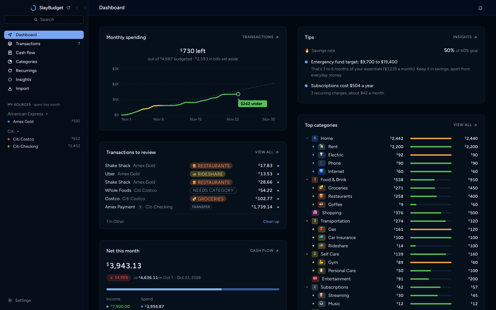
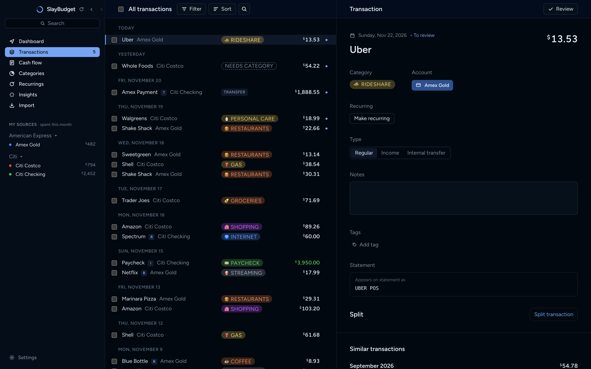
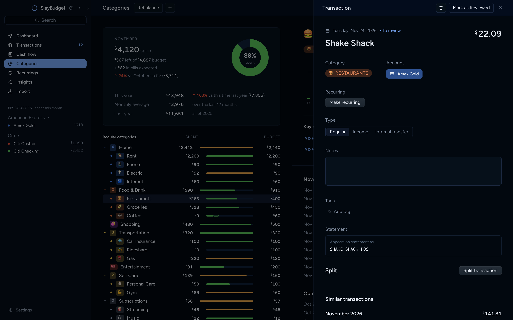
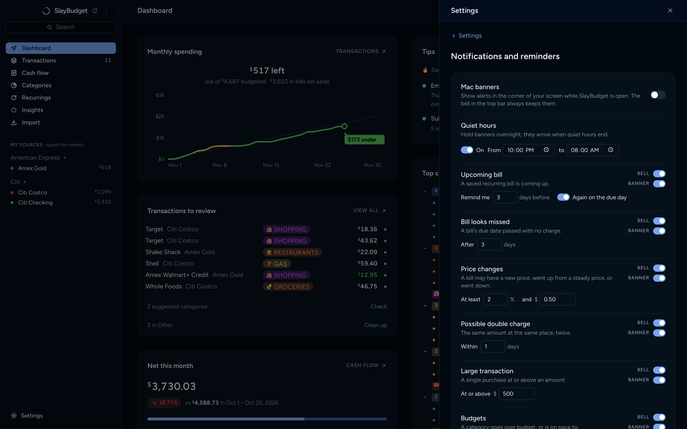
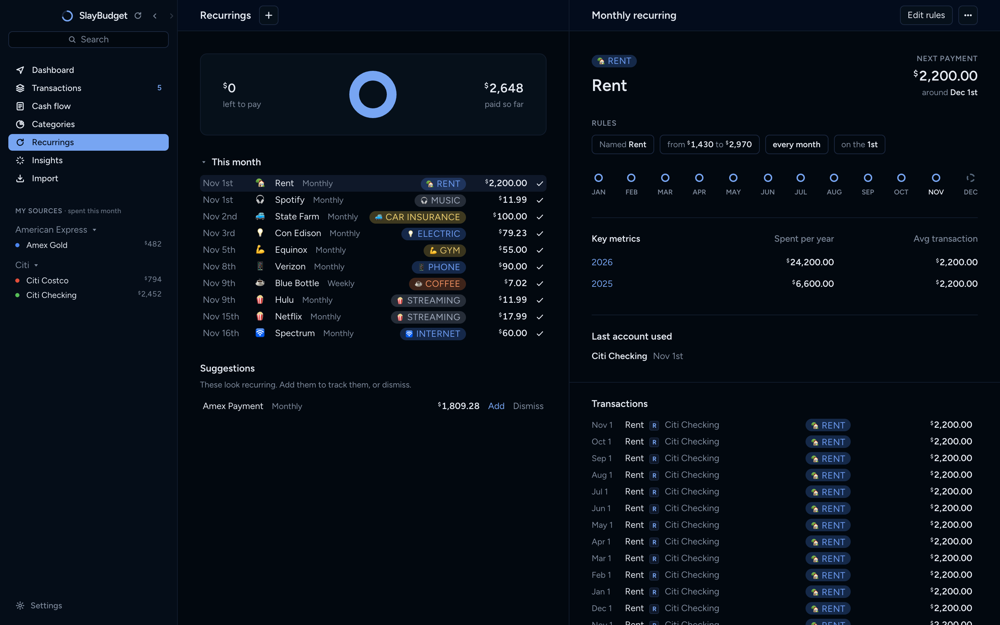
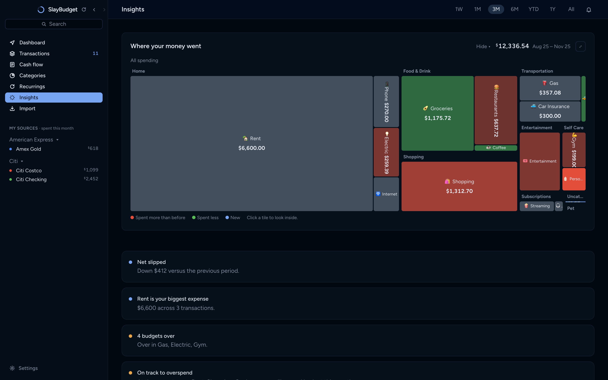
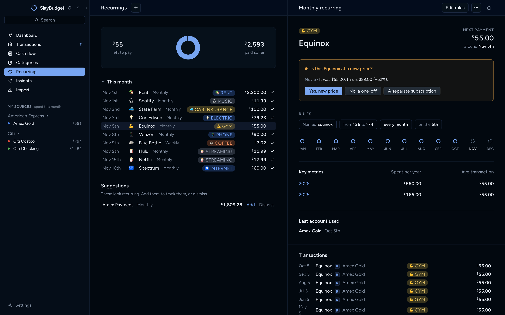
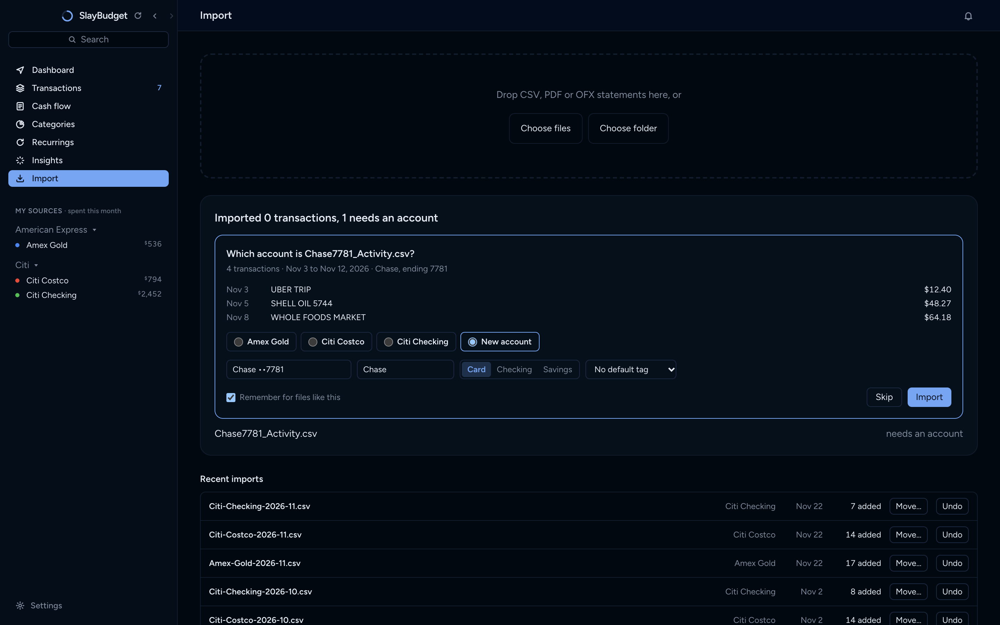

<div align="center">

# SlayBudget

### The free, private, local-first budgeting app for Mac

Import your bank statements, let SlayBudget categorize every transaction, and see exactly where your money goes.<br>
**No subscription. No bank login. No cloud.** Your financial data never leaves your Mac.

[](LICENSE)
[](#install) [](#windows-and-linux-untested)
[](https://tauri.app)
[](crates/core)
[](src)
[](https://github.com/ashvtol/SlayBudget/stargazers)

**[⬇️ Download for Mac](https://github.com/ashvtol/SlayBudget/releases/latest)** · [Windows and Linux (untested)](#windows-and-linux-untested)<br><br>[Features](#features) · [Screenshots](#screenshots) · [Why local-first](#why-local-first) · [Install](#install) · [FAQ](#faq) · [Changelog](CHANGELOG.md) · [Contributing](#contributing)

<br>

<picture>
  <source media="(prefers-color-scheme: light)" srcset="docs/screenshots/dashboard-light.png">
  
</picture>

</div>

---

## Why SlayBudget?

Most budgeting apps want a monthly fee, your bank password and a copy of every transaction on their servers.
SlayBudget gives you the polish of a premium personal finance app as an **open-source, offline Mac app**:

- 💸 **Free forever**: MIT licensed, no trial, no paywall, nothing to cancel.
- 🔒 **Private by design**: one SQLite file on your Mac. No account, no telemetry, no third-party data aggregator.
- ⚡ **Fast and native**: a Rust core and a Tauri app (not Electron). Every screen answers in well under a second.
- 🧠 **Learns how you categorize**: correct a transaction once and similar ones follow.
- 🔔 **Tells you what matters**: bills coming up or missed, price increases, double charges and budgets running over,
  in an in-app bell and Mac banners that open exactly what they're about.
- 🎨 **Beautiful**: four themes, crisp charts, keyboard shortcuts and accessibility settings.

If you've been looking for a **Copilot Money alternative, a YNAB alternative or a Mint replacement** that keeps your data
on your own computer, this is it.

## Features

| Feature | What it does |
|---|---|
| 📥 **Statement import** | CSV, PDF and QFX/OFX. Built-in layouts for American Express, Citi credit cards and Citi checking, plus a generic CSV importer. Exact repeats are skipped. Drop files in, or let SlayBudget pick up statements from a watched folder or, if you like, your Downloads folder. |
| 🧭 **Statements land in the right account** | SlayBudget works out which account a statement belongs to from the file itself (the account's last 4 digits, the bank, its columns, or the account folder it's in). When it isn't sure, it asks once ("Which account is this?") with its best guess first, and remembers your answer. Two cards from the same bank never get mixed up. Each account can have a default tag (say "Business"), and an import that went to the wrong account can be moved. |
| 🏷️ **Smart categorization** | Merchant learning from your corrections, explicit rules, and bank-provided categories. Clean up "Other" in bulk with suggestions. |
| 🎯 **Budgets** | Monthly budgets per category or group, per-month overrides, rollovers, and one-click rebalancing. |
| 📊 **Dashboard** | Free to spend this month (with bills set aside), net income, transactions to review, top categories, upcoming bills, and tips with your savings rate against your goal. The spending line turns from green to yellow to orange as you get ahead of your budget's pace; point at any day to see what you'd spent and what the budget allowed by then. |
| 🗂️ **Categories** | 24 months of spending against budget, green within it and orange over. Point at a month to see it, click to open it, then open and edit any transaction in place. |
| 💵 **Cash flow** | Income, spending and net for this month, the last 4 weeks, 3 or 12 months, or year to date, compared with the previous period or year. Move across a chart and the card shows that month against the same month last year; Spend lists that month's categories. |
| 🔁 **Recurring bills and subscriptions** | Detected automatically, with due dates, reminders, amount ranges and pause or archive. When a subscription changes price (up or down), SlayBudget asks once, "Is this Equinox at a new price?", and the bill follows the new price with a price history. Two bills that look like the same subscription can be merged. |
| 🗺️ **Insights** | An interactive spending map for any time range: drill from category to merchant and see what grew. Below it, Your money habits looks at all your history (see the next row). |
| 🔥 **Your money habits** | Pick a money style, **FIRE** (Financial Independence, Retire Early) or **Soft saving**, and see your savings rate, your FI number (25 times a year of spending) and roughly how many years to independence, worked out from all your history. A suggested budget trims flexible spending toward a savings target you choose (needs and bills stay as they are, and you can leave any category out, or all of them, with the header checkbox); apply it in one click and ⌘Z takes it back. Tips cover the 50/30/20 split, an emergency fund target, spending that grew faster than income, what subscriptions cost a year, small purchases that add up, no-spend days and paying yourself first. Hide any tip; it comes back if its numbers change a lot. Mark categories as Essential to tell needs from wants. Rules of thumb, not financial advice. |
| ↔️ **Resizable panes** | Drag the line between a list and its detail to make either side wider (Transactions, Categories, Recurrings). SlayBudget remembers it per page; double-click puts it back. |
| 🔎 **Transactions** | Instant search, filters (category, tag, account, type, amount, date), splits, refunds, notes, tags, transfers and the original statement details. |
| 👯 **Possible duplicates** | Overlapping statements (a mid-month download, then the full statement; or the CSV, then the PDF) can carry the same purchase in a slightly different form. SlayBudget flags those on import: the same charge worded differently, a tip added after the fact, a card hold replaced by the final charge, or a pending charge that posted days later. Each one gets an amber "Possible duplicate" tag and a plain explanation. Delete either one, or mark it "Not a duplicate" and it never comes back. Nothing is ever removed for you. |
| 💱 **Your currency, offline** | Show every amount in your currency (30+ to choose from): transactions, totals, budgets, charts and bills, each converted at its own month's rate. The European Central Bank's rates are built into the app, so nothing goes online to convert, and your data keeps its original currency. Changing numbers roll like a ticker. |
| ↩️ **Undo and redo** | ⌘Z takes back your last change and ⇧⌘Z puts it back, 15 steps deep, like any Mac app: a category, a bulk "apply to others", a delete (with its splits and tags), a budget, an import. The Edit menu names the step ("Undo Change Category"). |
| 🗑️ **Delete and undo imports** | Delete any transactions (one or many), or undo a whole import from Recent imports. Both ask first and back up your data before changing anything. |
| 🔔 **Notifications** | A bell in every screen's top bar, plus Mac banners: upcoming and missed bills, subscription price changes, possible double charges, large transactions, budgets over or on pace to overspend, a monthly recap, a weekly review reminder, paychecks or refunds arriving, and new money tips. Click one to jump straight to it. Quiet hours, and every threshold is yours to tune. |
| ⬆️ **Automatic updates** | Signed updates from GitHub. SlayBudget shows what's new since your version and installs only when you click. |
| 👨‍👩‍👧 **Profiles** | Keep household members' accounts separate, or view everything combined. |
| 🛡️ **Your data, your rules** | One-click database backup, and a rules export that leaves out anything identifying you. |
| ♿ **Accessible** | Light, dark and system themes, reduced motion, signed amounts and full keyboard navigation. |

## Screenshots

> Every screenshot uses the built-in sample data. No real financial data is shown.

### Transactions: search, review and edit in one place


### Categories: budgets against 24 months of history


### Edit any transaction without leaving the page


<table>
<tr>
<td width="50%">

**Notifications: the bell**


</td>
<td width="50%">

**Tune every alert**


</td>
</tr>
<tr>
<td width="50%">

**Cash flow**


</td>
<td width="50%">

**Recurring bills and subscriptions**


</td>
</tr>
<tr>
<td width="50%">

**Insights: where your money went**


</td>
<td width="50%">

**Daylight theme**


</td>
</tr>
</table>

<table>
<tr>
<td width="50%">

**Possible duplicates: why, and what to do**


</td>
<td width="50%">

**Recent imports, each one undoable**


</td>
</tr>
</table>

### A subscription changed price? Asked once


### Your money habits: FIRE or Soft saving, a suggested budget and tips


### Which account is this? Asked once, then remembered


### Four themes: Navy, Daylight, Aurora and Graphite


## Why local-first?

| | SlayBudget | Typical budgeting apps |
|---|:---:|:---:|
| Price | **Free (MIT)** | Paid subscription |
| Where your transactions live | **On your Mac** | Their cloud |
| Needs your bank login | **No**: you import statements | Usually, through an aggregator |
| Works offline | **Yes** | No |
| Open source | **Yes** | No |
| Export and back up everything | **One click** | Varies |

SlayBudget reads the statements you download yourself and never sends them anywhere. You own the data, it works on a
plane, and there's nothing to cancel.

## Install

**[⬇️ Download the latest SlayBudget for Mac](https://github.com/ashvtol/SlayBudget/releases/latest)** (a universal DMG
for Apple Silicon and Intel, macOS 13 or later).

1. Open the DMG and drag **SlayBudget** to **Applications**.
2. The first time, right-click SlayBudget in Applications and choose **Open** (or go to System Settings > Privacy &
   Security > **Open Anyway**). SlayBudget isn't notarized by Apple yet, so macOS asks once.
3. If macOS says the app "is damaged", run this once in Terminal, then open it again:
   ```sh
   xattr -dr com.apple.quarantine /Applications/SlayBudget.app
   ```

**Updates are automatic.** SlayBudget checks for new versions when it opens and every 6 hours, shows you what's new
since your version, and installs only when you click. See the [changelog](CHANGELOG.md).

### Windows and Linux (untested)

Every release also builds SlayBudget for Windows and Linux, from the same code. **These builds haven't been tested on a
real Windows or Linux machine yet**, so expect rough edges. If something doesn't work, please
[open an issue](https://github.com/ashvtol/SlayBudget/issues) with your OS version and what you saw.

- **Windows 10 or 11 (64-bit):** download **SlayBudget_*_x64-setup.exe** (or the **.msi**) from the
  [latest release](https://github.com/ashvtol/SlayBudget/releases/latest) and run it. The installer isn't code-signed
  yet, so SmartScreen may say "Windows protected your PC": choose **More info > Run anyway**.
- **Linux (64-bit):** download the **.AppImage**, make it executable (`chmod +x SlayBudget_*.AppImage`) and run it, or
  install the **.deb** on Debian and Ubuntu (`sudo apt install ./SlayBudget_*.deb`).

What's different from the Mac app: shortcuts use **Ctrl** instead of ⌘ (Ctrl+Z / Ctrl+Y to undo and redo), the window
has the system's own title bar, and notifications are the system's standard ones (clicking one doesn't open the item
yet). Updates are automatic here too.

### Build from source

Prerequisites: Xcode Command Line Tools (`xcode-select --install`), [Rust](https://rustup.rs) and Node.js 22+.

```sh
git clone https://github.com/ashvtol/SlayBudget.git
cd SlayBudget
npm install
npm run dev                          # try it in your browser with sample data
npx tauri build --bundles app        # or build SlayBudget.app
```

Your data lives in `~/Library/Application Support/dev.ashvtol.slaybudget/slaybudget.db`.

## Organizing statements with folders

You can drop statements in from anywhere: SlayBudget works out the account from what's in the file, or asks you once
and remembers. If you like folders, give each account its own folder and SlayBudget does the rest:

```text
Statements/              ← your watched folder (Settings > Import sources)
├── Amex Gold/           → imported into Amex Gold
│   └── 2026-11.csv
└── Citi Checking/       → imported into Citi Checking, tagged "Bills" (its default tag)
    └── november.pdf
```

1. Choose a watched folder in **Settings > Import sources**.
2. In **Settings > Accounts**, click **Create a folder for each account**.
3. Drop statements into the right folder. SlayBudget checks every couple of minutes and the bell tells you what it
   imported.

**Folder → account → tag.** The folder decides the account. If that account has a **default tag** (Settings >
Accounts), everything it imports gets that tag too, so a "Business" card's folder fills up your Business tag on its
own. A folder whose name doesn't match an account is asked about once, with the folder's name suggested for a new
account. Files are only read, never moved or changed.

## FAQ

<details>
<summary><b>Is SlayBudget really free?</b></summary>

Yes. It's open source under the MIT license, with no paid tier and no ads.
</details>

<details>
<summary><b>Does it connect to my bank?</b></summary>

No. You download statements (CSV, PDF or QFX) from your bank's website and drop them in, or point SlayBudget at a
folder. Nothing logs in to your bank and no third party sees your transactions.
</details>

<details>
<summary><b>Which banks and card issuers are supported?</b></summary>

American Express and Citi (credit cards and checking) have dedicated importers. Any bank that exports CSV works with
the generic importer, and QFX/OFX files work from most US banks. New layouts are easy to add: see
`crates/core/src/import`.
</details>

<details>
<summary><b>Is my financial data private?</b></summary>

Yes. Everything is stored in one local SQLite database. There's no account, no telemetry and no server. Back it up
from Settings > Data and backup, or with Time Machine.
</details>

<details>
<summary><b>Can I move from another budgeting app?</b></summary>

Yes. Import transactions from a JSON export, and import categorization rules so your merchants are categorized the way
you're used to.
</details>

<details>
<summary><b>Will it remind me about bills?</b></summary>

Yes. The bell in the top bar and Mac banners tell you about upcoming bills (as many days ahead as you like), bills
that look missed, price changes, possible double charges, large purchases and budgets running over. Banners appear
while SlayBudget is open, and quiet hours hold them overnight.
</details>

<details>
<summary><b>I don't see Mac banners. What's wrong?</b></summary>

Open Settings > Notifications and reminders. Under "Mac banners" SlayBudget says what macOS does with its banners:
shows them, only puts them in Notification Center (set SlayBudget's alert style to Banners), blocks them, or hasn't
been asked yet (click **Allow banners**). **Open System Settings** takes you straight there. **Send a test banner** at
the bottom shows one right away. Banners pop up even while SlayBudget is in front. They don't while it's quit, during
quiet hours (held until they end), for kinds whose Banner switch is off, for alerts you already read in the bell, or
in a Focus mode; more than 3 at once arrive as one summary banner.
</details>

<details>
<summary><b>How does SlayBudget know which account a statement is?</b></summary>

From the file itself: the account's last 4 digits (in a PDF, a QFX file, an Amex CSV or a file name like
`Chase1004_Activity.csv`), the bank, the CSV's columns, or the account folder it sits in. When that's not enough, it
asks you once, with its best guess first, and remembers your answer, so next month's statement goes straight in. You
can see and change what each account is recognized by in Settings > Accounts, move an import to another account from
Recent imports, and have SlayBudget make a folder for each account in your watched folder.
</details>

<details>
<summary><b>Can it import statements from my Downloads folder?</b></summary>

Yes, if you turn it on in Settings > Import sources. Statements you download from then on are imported on their own
(ones it can't place wait on the Import page), anything that isn't a statement is ignored, and your files are never
moved or changed.
</details>

<details>
<summary><b>Can I see everything in another currency?</b></summary>

Yes. Pick a display currency in Settings > Currency and every amount is shown in it, converted at the average rate of
its own month (or at the latest rates, if you prefer). The rates are the European Central Bank's monthly averages,
built into SlayBudget and refreshed with each update, so converting never goes online. Your data keeps the currency
it was imported in, and a converted transaction shows what it originally was.
</details>

<details>
<summary><b>A subscription changed price. Does SlayBudget notice?</b></summary>

Yes. A saved bill claims charges near its usual amount. When a charge from the same merchant comes in well above or
below that (an upgrade, a downgrade, a new plan), SlayBudget asks once: "Is this Netflix at a new price?" Say **Yes,
new price** and the bill follows the new amount and due day, keeping a price history; **No, a one-off** leaves the
bill alone; **A separate subscription** makes it its own bill. The question shows on the charge, on the bill in
Recurrings and in the bell. If you end up with two bills for the same subscription, Recurrings offers to merge them
(⌘Z undoes it).
</details>

<details>
<summary><b>Can I undo a mistake?</b></summary>

Yes. ⌘Z undoes your last change and ⇧⌘Z redoes it, up to 15 steps back: categories (including "apply to others"),
reviews, notes, tags, splits, deletes, budgets, recurring bills, rules and imports. While you're typing in a field, ⌘Z
undoes your typing instead. Settings aren't part of undo, and the steps are cleared when you quit.
</details>

<details>
<summary><b>What if I import overlapping statements?</b></summary>

Rows that match exactly are skipped, so importing the full month after a mid-month download only adds what's new.
Rows that look like ones you already have but don't match exactly (a PDF that words a merchant differently, a tip
added after the fact, a card hold, or a pending charge that posted days later) are imported, tagged "Possible
duplicate" and marked to review, with an explanation. Filter by the tag, then delete one of the pair or mark it "Not a
duplicate". SlayBudget never deletes anything on its own. If a whole import was a mistake, undo it from Recent
imports on the Import page.
</details>

<details>
<summary><b>Where do the FIRE numbers come from?</b></summary>

From your own transactions, on your Mac. Your savings rate is income minus spending over the last 12 full months.
The FI number is 25 times a year of spending (the "4% rule"; the 3.5% figure beside it is the more careful version
for early retirement). Years to FI assume you start from zero, earn 5% a year after inflation and withdraw 4%: about
17 years at a 50% savings rate. They're illustrations and rules of thumb, not financial advice.
</details>

<details>
<summary><b>I hid a tip. Why did it come back?</b></summary>

A hidden tip stays hidden until its numbers change a lot: more than 10% (or 3 points for a percentage, like your
50/30/20 split). Then it's news again. You can also bring any hidden tip back from "hidden tips" under the list.
</details>

<details>
<summary><b>Will SlayBudget tell me about a new tip?</b></summary>

Yes. After each import (and when the app starts) it checks Your money habits, and a tip that's new, came back after you
hid it, or turned into a warning goes to the bell, and to a Mac banner if banners are on. Clicking it opens the tips on
Insights. More than 3 at once arrive as one. Turn them off under Settings → Notifications → Money tips. The no-spend
days tip never notifies (it changes every day), and the first check after updating stays quiet.
</details>

<details>
<summary><b>Windows or Linux?</b></summary>

Yes, but untested: every release includes Windows and Linux builds, made automatically from the same code, which
haven't been tried on a real Windows or Linux machine yet. See [Windows and Linux (untested)](#windows-and-linux-untested)
for how to install them, and please open an issue if something doesn't work. SlayBudget is designed and tested on
macOS. Contributions are welcome.
</details>

## Tech stack

**Tauri 2** · **Rust** (rusqlite, SQLite) · **React 19** · **TypeScript** · **Vite** · **Tailwind CSS** · **visx** ·
**Zustand** · **Vitest**

```
crates/core   Rust business logic: storage and migrations, importers, categorization, budgets, analytics
src-tauri     The Tauri app shell and commands
src           The React UI
```

Money is stored as integer cents, never as floating point. Design decisions live in `SPEC.md`, `CONSTRAINTS.md` and
`docs/adr/`.

## Contributing

Contributions are welcome: new bank importers, features and fixes. Start with
[CONTRIBUTING.md](CONTRIBUTING.md), and run `npm run check` before opening a pull request.

If SlayBudget helps you, **please ⭐ star the repo**. It helps other people find a private, free budgeting app.

## License

[MIT](LICENSE) © ashvtol

<sub>SlayBudget is an independent project and is not affiliated with Copilot Money, YNAB, Intuit or Mint. Product names
are used only to describe compatibility and alternatives.</sub>
