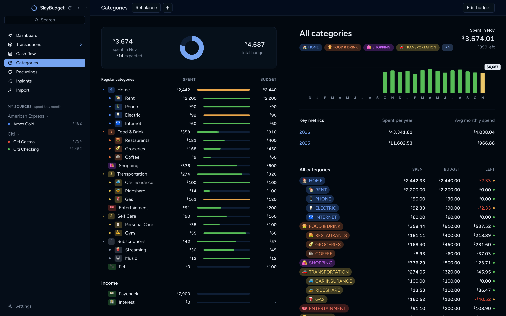
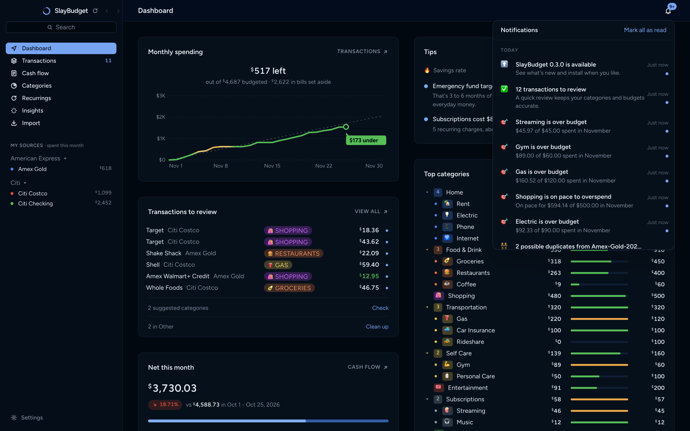
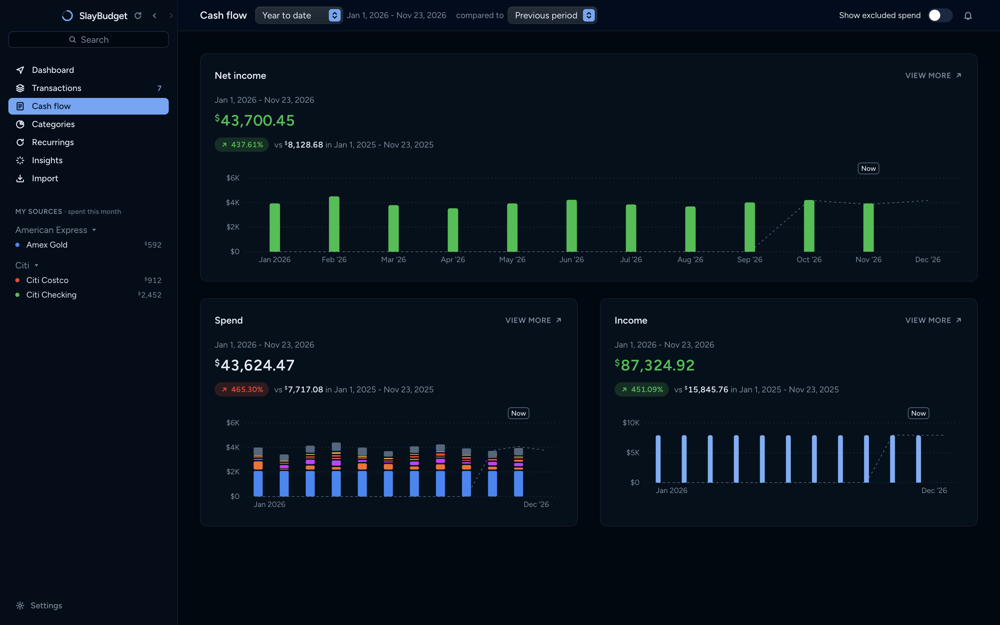
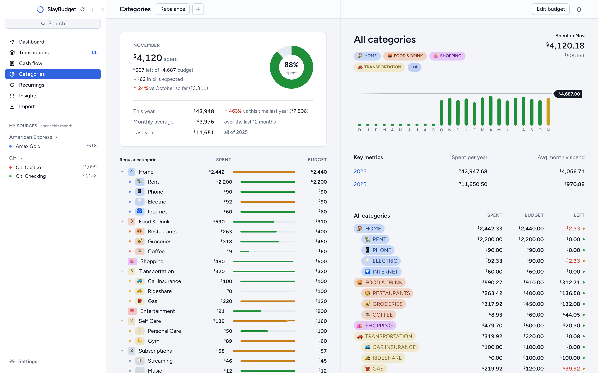
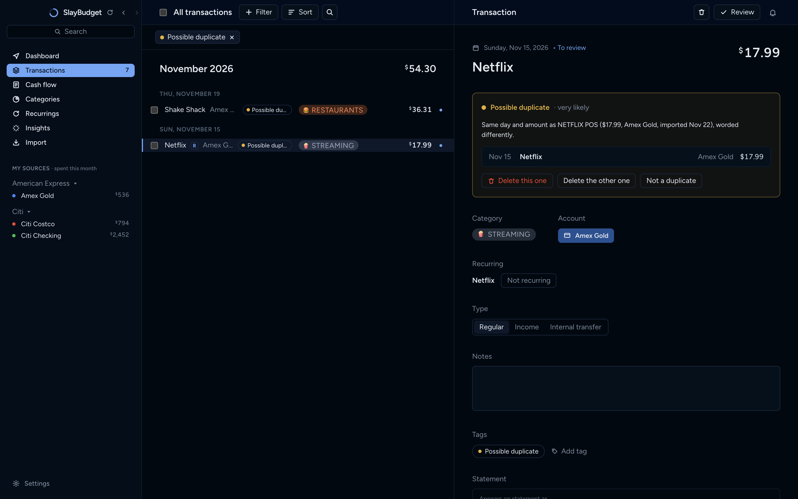
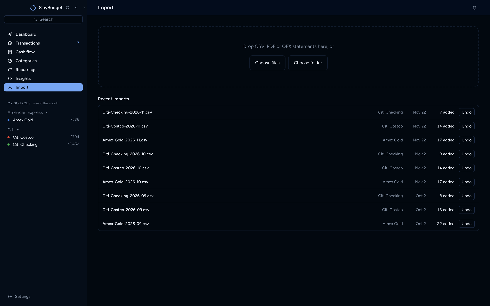
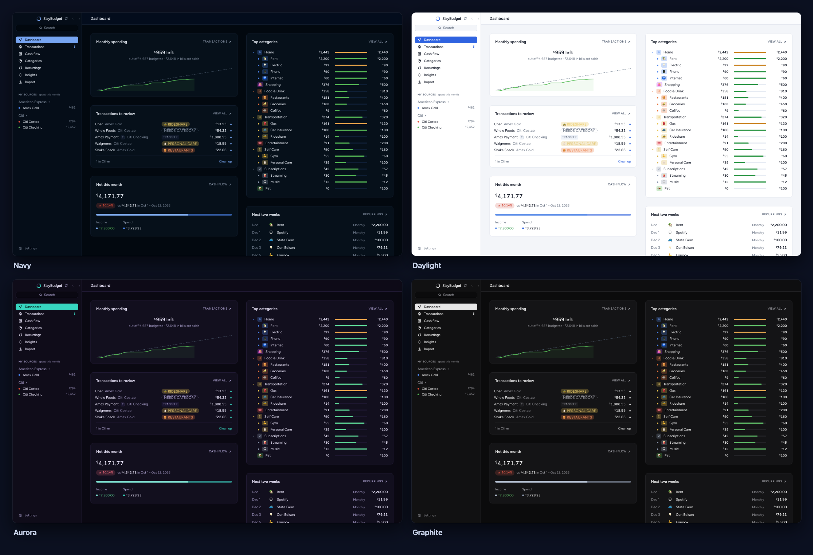

<div align="center">

# SlayBudget

### The free, private, local-first budgeting app for Mac

Import your bank statements, let SlayBudget categorize every transaction, and see exactly where your money goes.<br>
**No subscription. No bank login. No cloud.** Your financial data never leaves your Mac.

[](LICENSE)
[](#install)
[](https://tauri.app)
[](crates/core)
[](src)
[](https://github.com/ashvtol/SlayBudget/stargazers)

**[⬇️ Download for Mac](https://github.com/ashvtol/SlayBudget/releases/latest)**<br><br>[Features](#features) · [Screenshots](#screenshots) · [Why local-first](#why-local-first) · [Install](#install) · [FAQ](#faq) · [Changelog](CHANGELOG.md) · [Contributing](#contributing)

<br>

<picture>
  <source media="(prefers-color-scheme: light)" srcset="docs/screenshots/dashboard-light.png">
  
</picture>

</div>

---

## Why SlayBudget?

Most budgeting apps want a monthly fee, your bank password and a copy of every transaction on their servers.
SlayBudget gives you the polish of a premium personal finance app as an **open-source, offline Mac app**:

- 💸 **Free forever**: MIT licensed, no trial, no paywall, nothing to cancel.
- 🔒 **Private by design**: one SQLite file on your Mac. No account, no telemetry, no third-party data aggregator.
- ⚡ **Fast and native**: a Rust core and a Tauri app (not Electron). Every screen answers in well under a second.
- 🧠 **Learns how you categorize**: correct a transaction once and similar ones follow.
- 🔔 **Tells you what matters**: bills coming up or missed, price increases, double charges and budgets running over,
  in an in-app bell and Mac banners that open exactly what they're about.
- 🎨 **Beautiful**: four themes, crisp charts, keyboard shortcuts and accessibility settings.

If you've been looking for a **Copilot Money alternative, a YNAB alternative or a Mint replacement** that keeps your data
on your own computer, this is it.

## Features

| Feature | What it does |
|---|---|
| 📥 **Statement import** | CSV, PDF and QFX/OFX. Built-in layouts for American Express, Citi credit cards and Citi checking, plus a generic CSV importer. Exact repeats are skipped, and a watched folder imports new statements automatically. |
| 🏷️ **Smart categorization** | Merchant learning from your corrections, explicit rules, and bank-provided categories. Clean up "Other" in bulk with suggestions. |
| 🎯 **Budgets** | Monthly budgets per category or group, per-month overrides, rollovers, and one-click rebalancing. |
| 📊 **Dashboard** | Free to spend this month (with bills set aside), net income, transactions to review, top categories and upcoming bills. |
| 🗂️ **Categories** | 24 months of spending against budget. Click any month to see that month, then open and edit any transaction in place. |
| 💵 **Cash flow** | Income, spending and net for this month, the last 4 weeks, 3 or 12 months, or year to date, compared with the previous period or year. |
| 🔁 **Recurring bills and subscriptions** | Detected automatically, with due dates, reminders, amount ranges and pause or archive. |
| 🗺️ **Insights** | An interactive spending map: drill from category to merchant and see what grew. |
| 🔎 **Transactions** | Instant search, filters (category, tag, account, type, amount, date), splits, refunds, notes, tags, transfers and the original statement details. |
| 👯 **Possible duplicates** | Overlapping statements (a mid-month download, then the full statement; or the CSV, then the PDF) can carry the same purchase in a slightly different form. SlayBudget flags those on import: the same charge worded differently, a tip added after the fact, a card hold replaced by the final charge, or a pending charge that posted days later. Each one gets an amber "Possible duplicate" tag and a plain explanation. Delete either one, or mark it "Not a duplicate" and it never comes back. Nothing is ever removed for you. |
| ↩️ **Undo and redo** | ⌘Z takes back your last change and ⇧⌘Z puts it back, 15 steps deep, like any Mac app: a category, a bulk "apply to others", a delete (with its splits and tags), a budget, an import. The Edit menu names the step ("Undo Change Category"). |
| 🗑️ **Delete and undo imports** | Delete any transactions (one or many), or undo a whole import from Recent imports. Both ask first and back up your data before changing anything. |
| 🔔 **Notifications** | A bell in every screen's top bar, plus Mac banners: upcoming and missed bills, subscription price increases, possible double charges, large transactions, budgets over or on pace to overspend, a monthly recap, a weekly review reminder, and paychecks or refunds arriving. Click one to jump straight to it. Quiet hours, and every threshold is yours to tune. |
| ⬆️ **Automatic updates** | Signed updates from GitHub. SlayBudget shows what's new since your version and installs only when you click. |
| 👨‍👩‍👧 **Profiles** | Keep household members' accounts separate, or view everything combined. |
| 🛡️ **Your data, your rules** | One-click database backup, and a rules export that leaves out anything identifying you. |
| ♿ **Accessible** | Light, dark and system themes, reduced motion, signed amounts and full keyboard navigation. |

## Screenshots

> Every screenshot uses the built-in sample data. No real financial data is shown.

### Transactions: search, review and edit in one place


### Categories: budgets against 24 months of history


### Edit any transaction without leaving the page


<table>
<tr>
<td width="50%">

**Notifications: the bell**


</td>
<td width="50%">

**Tune every alert**


</td>
</tr>
<tr>
<td width="50%">

**Cash flow**


</td>
<td width="50%">

**Recurring bills and subscriptions**


</td>
</tr>
<tr>
<td width="50%">

**Insights: where your money went**


</td>
<td width="50%">

**Daylight theme**


</td>
</tr>
</table>

<table>
<tr>
<td width="50%">

**Possible duplicates: why, and what to do**


</td>
<td width="50%">

**Recent imports, each one undoable**


</td>
</tr>
</table>

### Four themes: Navy, Daylight, Aurora and Graphite


## Why local-first?

| | SlayBudget | Typical budgeting apps |
|---|:---:|:---:|
| Price | **Free (MIT)** | Paid subscription |
| Where your transactions live | **On your Mac** | Their cloud |
| Needs your bank login | **No**: you import statements | Usually, through an aggregator |
| Works offline | **Yes** | No |
| Open source | **Yes** | No |
| Export and back up everything | **One click** | Varies |

SlayBudget reads the statements you download yourself and never sends them anywhere. You own the data, it works on a
plane, and there's nothing to cancel.

## Install

**[⬇️ Download the latest SlayBudget for Mac](https://github.com/ashvtol/SlayBudget/releases/latest)** (a universal DMG
for Apple Silicon and Intel, macOS 13 or later).

1. Open the DMG and drag **SlayBudget** to **Applications**.
2. The first time, right-click SlayBudget in Applications and choose **Open** (or go to System Settings > Privacy &
   Security > **Open Anyway**). SlayBudget isn't notarized by Apple yet, so macOS asks once.
3. If macOS says the app "is damaged", run this once in Terminal, then open it again:
   ```sh
   xattr -dr com.apple.quarantine /Applications/SlayBudget.app
   ```

**Updates are automatic.** SlayBudget checks for new versions when it opens and every 6 hours, shows you what's new
since your version, and installs only when you click. See the [changelog](CHANGELOG.md).

### Build from source

Prerequisites: Xcode Command Line Tools (`xcode-select --install`), [Rust](https://rustup.rs) and Node.js 22+.

```sh
git clone https://github.com/ashvtol/SlayBudget.git
cd SlayBudget
npm install
npm run dev                          # try it in your browser with sample data
npx tauri build --bundles app        # or build SlayBudget.app
```

Your data lives in `~/Library/Application Support/dev.ashvtol.slaybudget/slaybudget.db`.

## FAQ

<details>
<summary><b>Is SlayBudget really free?</b></summary>

Yes. It's open source under the MIT license, with no paid tier and no ads.
</details>

<details>
<summary><b>Does it connect to my bank?</b></summary>

No. You download statements (CSV, PDF or QFX) from your bank's website and drop them in, or point SlayBudget at a
folder. Nothing logs in to your bank and no third party sees your transactions.
</details>

<details>
<summary><b>Which banks and card issuers are supported?</b></summary>

American Express and Citi (credit cards and checking) have dedicated importers. Any bank that exports CSV works with
the generic importer, and QFX/OFX files work from most US banks. New layouts are easy to add: see
`crates/core/src/import`.
</details>

<details>
<summary><b>Is my financial data private?</b></summary>

Yes. Everything is stored in one local SQLite database. There's no account, no telemetry and no server. Back it up
from Settings > Data and backup, or with Time Machine.
</details>

<details>
<summary><b>Can I move from another budgeting app?</b></summary>

Yes. Import transactions from a JSON export, and import categorization rules so your merchants are categorized the way
you're used to.
</details>

<details>
<summary><b>Will it remind me about bills?</b></summary>

Yes. The bell in the top bar and Mac banners tell you about upcoming bills (as many days ahead as you like), bills
that look missed, price increases, possible double charges, large purchases and budgets running over. Banners appear
while SlayBudget is open, and quiet hours hold them overnight.
</details>

<details>
<summary><b>Can I undo a mistake?</b></summary>

Yes. ⌘Z undoes your last change and ⇧⌘Z redoes it, up to 15 steps back: categories (including "apply to others"),
reviews, notes, tags, splits, deletes, budgets, recurring bills, rules and imports. While you're typing in a field, ⌘Z
undoes your typing instead. Settings aren't part of undo, and the steps are cleared when you quit.
</details>

<details>
<summary><b>What if I import overlapping statements?</b></summary>

Rows that match exactly are skipped, so importing the full month after a mid-month download only adds what's new.
Rows that look like ones you already have but don't match exactly (a PDF that words a merchant differently, a tip
added after the fact, a card hold, or a pending charge that posted days later) are imported, tagged "Possible
duplicate" and marked to review, with an explanation. Filter by the tag, then delete one of the pair or mark it "Not a
duplicate". SlayBudget never deletes anything on its own. If a whole import was a mistake, undo it from Recent
imports on the Import page.
</details>

<details>
<summary><b>Windows or Linux?</b></summary>

The app is built with Tauri, which supports both, but SlayBudget is designed and tested on macOS today. Contributions
are welcome.
</details>

## Tech stack

**Tauri 2** · **Rust** (rusqlite, SQLite) · **React 19** · **TypeScript** · **Vite** · **Tailwind CSS** · **ECharts** ·
**Zustand** · **Vitest**

```
crates/core   Rust business logic: storage and migrations, importers, categorization, budgets, analytics
src-tauri     The Tauri app shell and commands
src           The React UI
```

Money is stored as integer cents, never as floating point. Design decisions live in `SPEC.md`, `CONSTRAINTS.md` and
`docs/adr/`.

## Contributing

Contributions are welcome: new bank importers, features and fixes. Start with
[CONTRIBUTING.md](CONTRIBUTING.md), and run `npm run check` before opening a pull request.

If SlayBudget helps you, **please ⭐ star the repo**. It helps other people find a private, free budgeting app.

## License

[MIT](LICENSE) © ashvtol

<sub>SlayBudget is an independent project and is not affiliated with Copilot Money, YNAB, Intuit or Mint. Product names
are used only to describe compatibility and alternatives.</sub>
